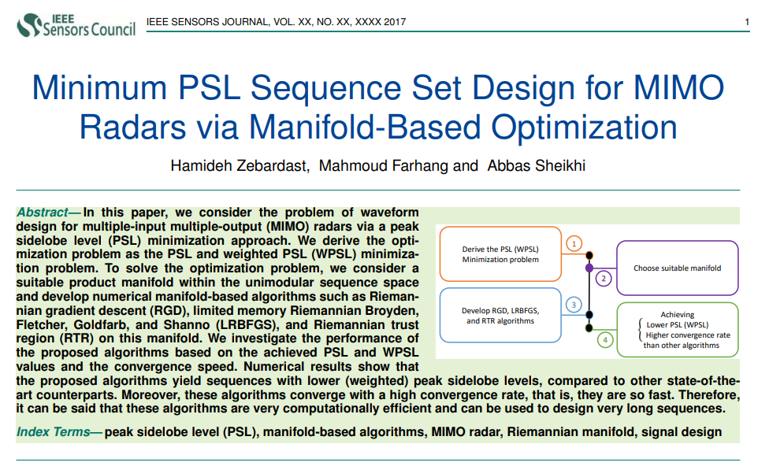
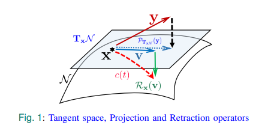
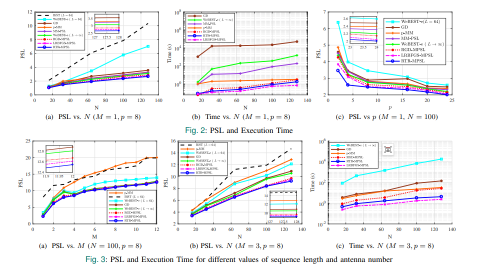
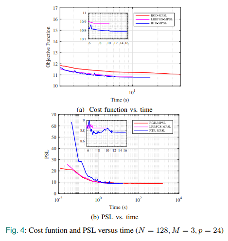
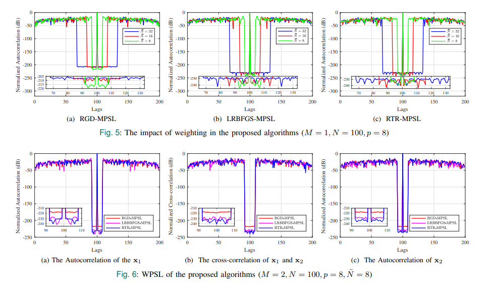

# Waveform Design: Minimum Peak Sidelobe Level Sequence Set Design for MIMO Radar Based on Manifold Optimization [with MATLAB Code]

In this paper, we investigate the waveform design problem for multi-input multi-output (MIMO) radars through the minimization of peak sidelobe level (PSL). We derive the optimization problem as a PSL and weighted PSL (WPSL) minimization issue. To address this optimization problem, we consider an appropriate product manifold within a single-mode sequence space and develop numerical algorithms based on the manifold, such as Riemannian gradient descent (RGD), finite memory Riemann Broyden-Fletcher-Goldfarb-Shanno (LRBFGS), and Riemann trust region (RTR) algorithms. We study the performance of these algorithms based on the obtained PSL and WPSL values, as well as their convergence speeds. Numerical results indicate that the proposed algorithms can generate sequences with lower (weighted) peak sidelobe levels compared to other state-of-the-art algorithms. Moreover, these algorithms converge quickly and are computationally efficient, making them suitable for designing long sequences.
Introduction: Signal design plays a crucial role in enhancing the performance of active sensor systems. In radar, high-precision target detection is essential, and many researchers have studied signal design to achieve better target detection and enhance anti-interference and anti-jamming capabilities. In this regard, the peak sidelobe level (PSL) of the transmitted sequence is a key design parameter. In single input single output (SISO) and single input multiple output (SIMO) radars, PSL is defined as the maximum sidelobe level of the autocorrelation function. Reducing PSL improves detection quality by avoiding the masking of weak targets by strong ones. In multi-input multiple-output (MIMO) radars, PSL refers to the maximum sidelobe level of both the autocorrelation and cross-correlation functions of the transmitted sequence. Like SISO and SIMO radars, reducing the sidelobe level of the autocorrelation function is equally important. Additionally, smaller cross-correlation sidelobe values enable MIMO radar receivers to distinguish between the transmitted waveforms and utilize waveform diversity to construct virtual arrays.
In certain applications, minimizing the weighted peak sidelobe level (WPSL) is a relevant design method that requires achieving the minimum sidelobe level within a specific range. For example, in tracking mode, the radar's search window is smaller than in search mode, so it is only necessary to minimize the sidelobes near the target, which can be achieved by minimizing WPSL.
Due to radars typically employing constant envelope signals for maximum power efficiency, most signal design issues are constrained by single-mode constraints. To date, several optimization-based algorithms have been proposed for designing single-mode sequences with the desired length and minimal PSL/WPSL. Some methods utilize maximization-minimization (MM) to solve the optimization problem. In this context, minimizing the lF norm and lp norm using a monotonic minimizer based on MM has been proposed in the literature. The maximization function primarily determines the convergence speed of the MM method. Several acceleration techniques have also been proposed to improve the convergence speed of such algorithms, but they only consider SISO radar sequence design. A gradient descent (GD) method for minimizing lp norm, which is based on block coordinate descent (BCD), is proposed in the literature. One of its main features is simplicity, but it uses a series of approximations to handle single-mode constraints. The binary sequence set (BiST) algorithm is based on the block coordinate descent (BCD) method for designing sequence sets with discrete phase constraints. The WeBEST method, which uses weighted BSUM sequence sets based on MM to minimize the tx norm of autocorrelation and cross-correlation sidelobes, optimizes different local approximation functions for blocks containing one code symbol or vector. These algorithms ensure convergence to smooth objective function stationary points, but their computational complexity is polynomial, which may make large-scale problems difficult to solve. Another iterational monotonic algorithm based on MM technology, called the PSL minimizer, has been proposed in the literature. This algorithm generates sequence sets by optimizing an exact PSL metric, with computationally efficient implementations through fast Fourier transform (FFT) operations. Its performance has been evaluated against MIMO radar angle-distance imaging application scenarios for detecting sequence sets design. A new algorithm based on MM framework has been developed in the literature, which converts complex pth-order polynomial minimization into a series of lower order simple optimization problems, simultaneously minimizing both PSL and integral sidelobe level (ISL), achieving good balance between them. Compared with other state-of-the-art ISL minimization algorithms, this method obtains slightly higher ISL but significantly lower PSL.
In this paper, we consider designing a constant modulus sequence set by minimizing the lp norm of auto- and cross-correlation sidelobes. Since optimization problems rarely have analytical solutions, numerical algorithms are typically required to solve these problems. The unit modulus condition hinders the direct application of conventional unconstrained numerical methods for solving this minimization problem, but we show that the problem can be transformed into an unconstrained problem on a Riemannian manifold. To this end, we selected three unconstrained optimization algorithms: gradient descent (GD), Broyden-Fletcher-Goldfarb-Shanno (BFGS), and trust region (TR), and applied them to suitable Riemannian manifolds. Compared with other state-of-the-art algorithms, these algorithms ensure faster convergence speeds and achieve lower PSL/WPSL, indicating their good performance.
Article illustration
Conclusion We designed single-modulus sequences with minimum PSL/WPSL in MIMO radar. The optimization problem for multisequence design within continuous phase space was derived and solved using flow-based numerical algorithms. Three unconstrained optimization methods (GD, BFGS, and TR) were extended to flow-based methods, and the RGD-MPSL, LRBFGS-MPSL, and RTR-MPSL algorithms were proposed. A suitable product manifold was selected in continuous phase space to implement the above algorithms. The performance of the proposed algorithms was evaluated through simulation results and compared with state-of-the-art algorithms. The results indicate that the proposed algorithms achieve lower (weighted) sidelobe levels with higher convergence speeds.
End

## Images

<!-- PAYMENT_BLOCK -->

## Get this dataset

- Payment link (Stripe): [Buy now](https://buy.stripe.com/3cs8yP7sY87d0vu9AB)
- Payment QR code: 

<!-- /PAYMENT_BLOCK -->
